

  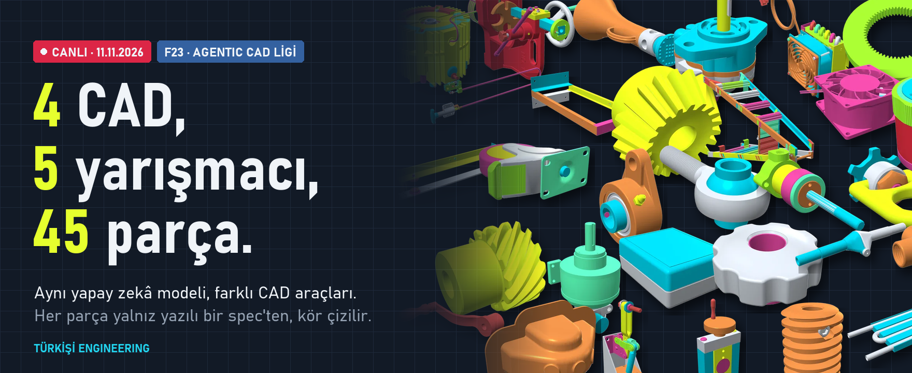

<h1 align="center">turkisi-cad · Agentic CAD Ligi (F23)</h1>

  <b>Aynı yapay zekâ modeli, farklı CAD araçları: hangisi gerçekten çiziyor?</b>

  
  
  
  
  

  <a href="#f23-nedir">F23 nedir?</a> ·
  <a href="#45-parça">45 parça</a> ·
  <a href="#i̇lk-sonuçlar">Sonuçlar</a> ·
  <a href="#hızlı-başlangıç-kendi-harnessını-bir-specte-dene">Hızlı başlangıç</a> ·
  <a href="#kanal-ve-yayın">Yayın</a> ·
  <a href="#klasörler">Klasörler</a>

---

Bu repo, Türkişi Engineering'in **F23 · Agentic CAD Ligi** canlı yayınının açık rehberidir. Yayında gösterilen her şey
burada: spec'ler, ölçüm kodu, koşu düzeneği, kontrol paneli, kurulum rehberleri, bitmiş modeller ve NX dışı CAD
skill'leri. Tek istisna Türkişi'nin özel **NX harness'i** ([aşağıya bakın](#nx-hariç)).

## F23 nedir?

Kör bir benchmark. Bir **Opus 5.5** yapımcı ajanı, **45 herkese açık katalog tarzı parçayı** yalnız yazılı bir
`spec.md`'den yeniden çizer. Orijinal modeli görmez, web'e çıkamaz; her araç çağrısı bir guard kancasından geçer.
Çıkan `final.step`, kilitli bir rubrikle ve aynı betikle (`olc.py`) orijinaline karşı ölçülür.

Model sabittir. Değişen yalnız **araç** ve elindeki **harness**:

| Config | Araç | Harness basamağı |
|---|---|---|
| **NX-H2** | Siemens NX 2206 | H2 · uzman harness (özel, paylaşılmıyor) |
| **SW-H1** | SolidWorks | H1 · topluluk MCP'si |
| **SC-H0** | SolidCraft | H0 · çıplak (yalnız CLI) |
| **B3D-H0** | build123d | H0 · çıplak (düz Python) |
| **B3D-H1** | build123d | H1 · topluluk MCP'si |

H0 = aracın kendi API'si, kod yazarak · H1 = H0 + topluluk MCP'si (en çok yıldızlı uygun olan; build123d'de ikinci
sıradaki build123d-mcp, çünkü birinci olan agentcad sürüm ve internet bağımlılığı yüzünden çıkarıldı) · H2 = H1 + uzman
skill'ler.

## 45 parça

Yapımcı ajan bu parçaların hiçbirini görmez; yalnız yazılı `spec.md`'sini okur. Görsele tıklayınca parçanın spec
klasörü açılır. **9** şekil · **22** zor · **14** çok zor. ⭐ = canlı yayındaki en iyi geçerli koşu (85 üzerinden);
yıldızı olmayan parçalar yayında koşulmadı.

<table>
<tr>
<td align="center" width="20%"><a href="benchmark/specs/P01-ic-disli-60-dis/">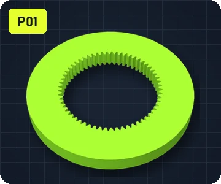</a> <b>P01</b> · iç dişli, 60 diş 🟢 şekil ⭐ 85,00 · NX-H2</td>
<td align="center" width="20%"><a href="benchmark/specs/P02-krank-kolu/">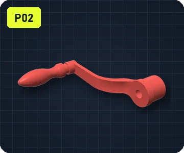</a> <b>P02</b> · krank kolu 🟢 şekil ⭐ 85,00 · SW-H1</td>
<td align="center" width="20%"><a href="benchmark/specs/P03-rulman-koruma-kapagi/">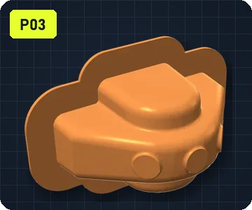</a> <b>P03</b> · rulman koruma kapağı 🟢 şekil ⭐ 54,25 · SC-H0</td>
<td align="center" width="20%"><a href="benchmark/specs/P04-abs-elektronik-kutusu/">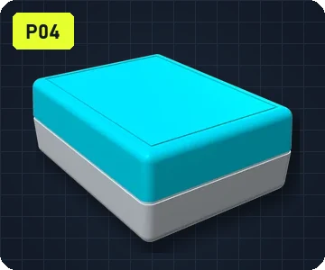</a> <b>P04</b> · ABS elektronik kutusu 🟠 zor ⭐ 79,74 · SW-H1</td>
<td align="center" width="20%"><a href="benchmark/specs/P05-rotil-basi/">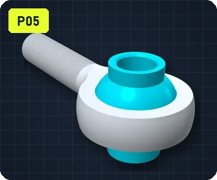</a> <b>P05</b> · rotil başı 🟠 zor ⭐ 84,21 · B3D-H1</td>
</tr>
<tr>
<td align="center" width="20%"><a href="benchmark/specs/P06-flansli-rulman-yatagi/">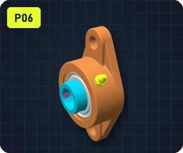</a> <b>P06</b> · flanşlı rulman yatağı 🟠 zor ⭐ 72,07 · NX-H2</td>
<td align="center" width="20%"><a href="benchmark/specs/P07-kollu-pres/">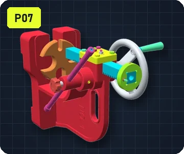</a> <b>P07</b> · kollu pres 🔴 çok zor</td>
<td align="center" width="20%"><a href="benchmark/specs/P08-havali-mengene/">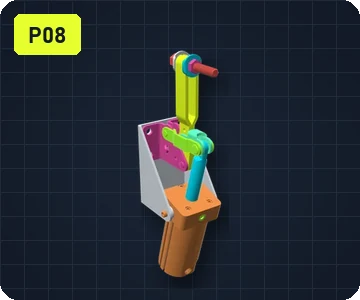</a> <b>P08</b> · havalı mengene 🔴 çok zor</td>
<td align="center" width="20%"><a href="benchmark/specs/P09-konumlama-kizagi/">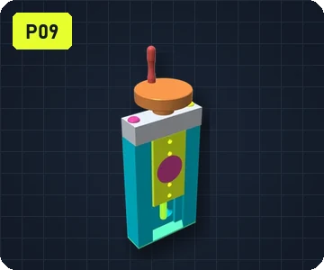</a> <b>P09</b> · konumlama kızağı 🔴 çok zor ⭐ 84,91 · B3D-H0</td>
<td align="center" width="20%"><a href="benchmark/specs/P10-tirtilli-topuz/">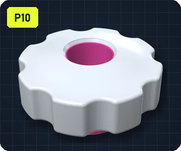</a> <b>P10</b> · tırtıllı topuz 🟢 şekil ⭐ 84,86 · NX-H2</td>
</tr>
<tr>
<td align="center" width="20%"><a href="benchmark/specs/P11-sonsuz-vida/">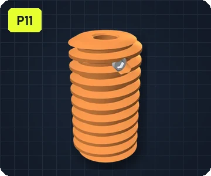</a> <b>P11</b> · sonsuz vida 🟢 şekil</td>
<td align="center" width="20%"><a href="benchmark/specs/P12-capraz-helis-disli/">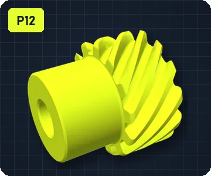</a> <b>P12</b> · çapraz helis dişli 🟢 şekil</td>
<td align="center" width="20%"><a href="benchmark/specs/P13-sogutma-plakasi/">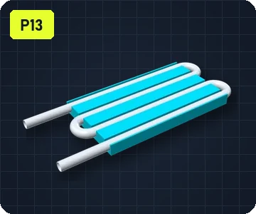</a> <b>P13</b> · soğutma plakası 🟠 zor</td>
<td align="center" width="20%"><a href="benchmark/specs/P14-bilyali-vida/">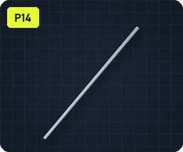</a> <b>P14</b> · bilyalı vida 🟢 şekil</td>
<td align="center" width="20%"><a href="benchmark/specs/P15-havali-reduktor-motor/">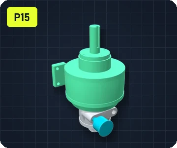</a> <b>P15</b> · havalı redüktör motor 🟠 zor</td>
</tr>
<tr>
<td align="center" width="20%"><a href="benchmark/specs/P16-konik-disli/">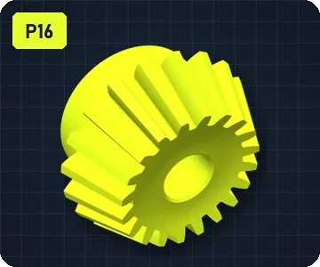</a> <b>P16</b> · konik dişli 🟢 şekil ⭐ 85,00 · SW-H1</td>
<td align="center" width="20%"><a href="benchmark/specs/P17-kanca-anahtar/">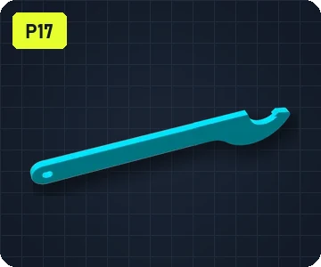</a> <b>P17</b> · kanca anahtar 🟢 şekil ⭐ 85,00 · B3D-H0 / SC-H0</td>
<td align="center" width="20%"><a href="benchmark/specs/P18-talas-siperi/">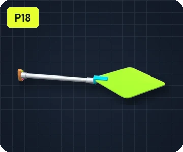</a> <b>P18</b> · talaş siperi 🟠 zor</td>
<td align="center" width="20%"><a href="benchmark/specs/P19-doner-tekerlek/">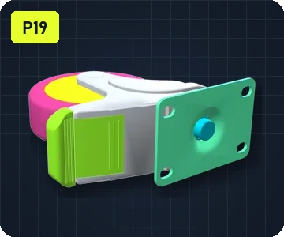</a> <b>P19</b> · döner tekerlek 🟠 zor ⭐ 84,32 · B3D-H0</td>
<td align="center" width="20%"><a href="benchmark/specs/P20-darbe-valfi/">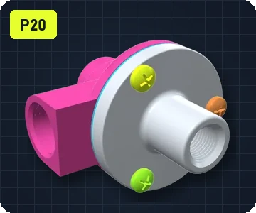</a> <b>P20</b> · darbe valfi 🟠 zor</td>
</tr>
<tr>
<td align="center" width="20%"><a href="benchmark/specs/P21-acili-kardan/">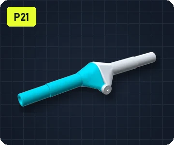</a> <b>P21</b> · açılı kardan 🟠 zor</td>
<td align="center" width="20%"><a href="benchmark/specs/P22-raf-konsolu/">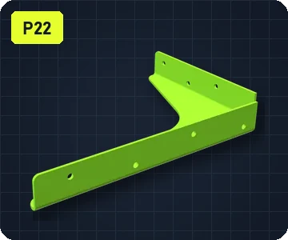</a> <b>P22</b> · raf konsolu 🟠 zor</td>
<td align="center" width="20%"><a href="benchmark/specs/P23-kilit-cift-baglantili/">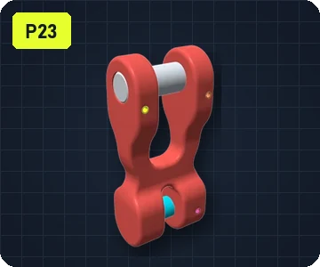</a> <b>P23</b> · kilit (çift bağlantılı) 🟠 zor</td>
<td align="center" width="20%"><a href="benchmark/specs/P24-ayarli-kol/">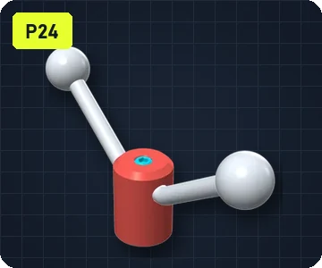</a> <b>P24</b> · ayarlı kol 🟠 zor</td>
<td align="center" width="20%"><a href="benchmark/specs/P25-gaz-debimetresi/">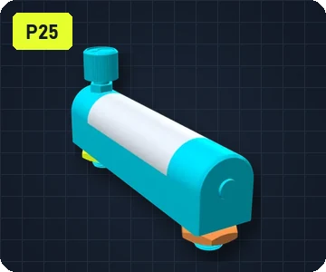</a> <b>P25</b> · gaz debimetresi 🟠 zor</td>
</tr>
<tr>
<td align="center" width="20%"><a href="benchmark/specs/P26-igne-valf/">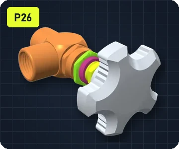</a> <b>P26</b> · iğne valf 🟠 zor</td>
<td align="center" width="20%"><a href="benchmark/specs/P27-gergi/">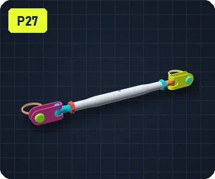</a> <b>P27</b> · gergi 🟠 zor</td>
<td align="center" width="20%"><a href="benchmark/specs/P28-filtre-govdesi/">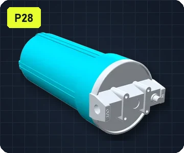</a> <b>P28</b> · filtre gövdesi 🟠 zor</td>
<td align="center" width="20%"><a href="benchmark/specs/P29-kaldirma-halkasi/">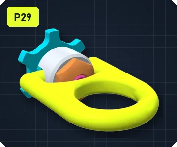</a> <b>P29</b> · kaldırma halkası 🟠 zor</td>
<td align="center" width="20%"><a href="benchmark/specs/P30-gaz-dolum-valfi/">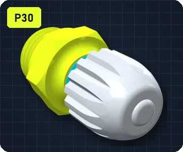</a> <b>P30</b> · gaz dolum valfi 🟠 zor</td>
</tr>
<tr>
<td align="center" width="20%"><a href="benchmark/specs/P31-manometre/">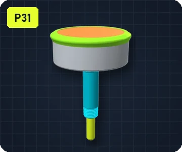</a> <b>P31</b> · manometre 🟠 zor</td>
<td align="center" width="20%"><a href="benchmark/specs/P32-sogutma-fani/">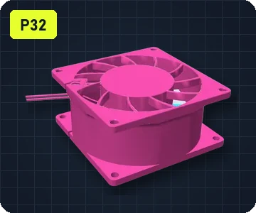</a> <b>P32</b> · soğutma fanı 🟠 zor</td>
<td align="center" width="20%"><a href="benchmark/specs/P33-doner-mandal/">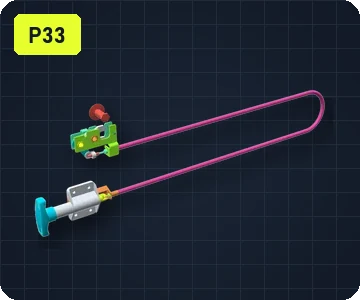</a> <b>P33</b> · döner mandal 🔴 çok zor</td>
<td align="center" width="20%"><a href="benchmark/specs/P34-hava-silindiri/">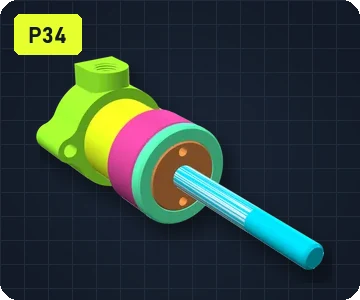</a> <b>P34</b> · hava silindiri 🟠 zor</td>
<td align="center" width="20%"><a href="benchmark/specs/P35-disli-pompa/">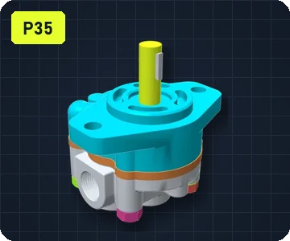</a> <b>P35</b> · dişli pompa 🔴 çok zor</td>
</tr>
<tr>
<td align="center" width="20%"><a href="benchmark/specs/P36-vidali-kriko/">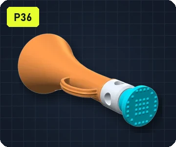</a> <b>P36</b> · vidalı kriko 🔴 çok zor</td>
<td align="center" width="20%"><a href="benchmark/specs/P37-elektronik-kabin-rafi/">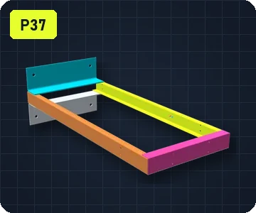</a> <b>P37</b> · elektronik kabin rafı 🔴 çok zor</td>
<td align="center" width="20%"><a href="benchmark/specs/P38-ac-reduktor-motor/">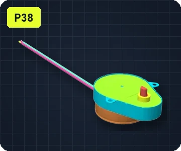</a> <b>P38</b> · AC redüktör motor 🔴 çok zor</td>
<td align="center" width="20%"><a href="benchmark/specs/P39-termometre/">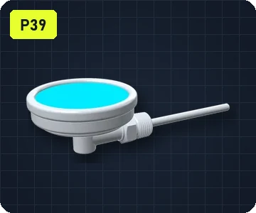</a> <b>P39</b> · termometre 🟠 zor</td>
<td align="center" width="20%"><a href="benchmark/specs/P40-manyetik-tork-sinirlayici/">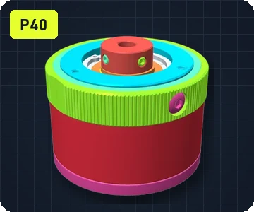</a> <b>P40</b> · manyetik tork sınırlayıcı 🔴 çok zor</td>
</tr>
<tr>
<td align="center" width="20%"><a href="benchmark/specs/P41-kavrama-fren/">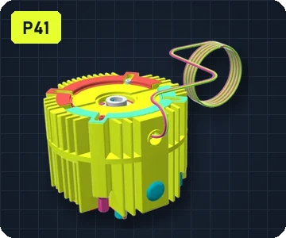</a> <b>P41</b> · kavrama-fren 🔴 çok zor</td>
<td align="center" width="20%"><a href="benchmark/specs/P42-kiris-arabasi/">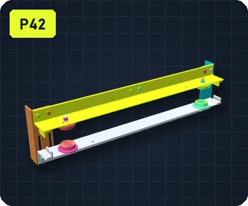</a> <b>P42</b> · kiriş arabası 🔴 çok zor</td>
<td align="center" width="20%"><a href="benchmark/specs/P43-platform-merdiven/">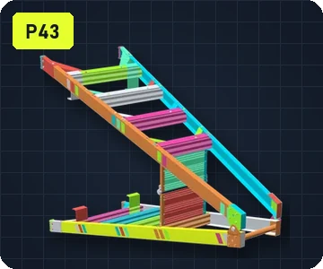</a> <b>P43</b> · platform merdiven 🔴 çok zor</td>
<td align="center" width="20%"><a href="benchmark/specs/P44-bilyali-vida-mil/">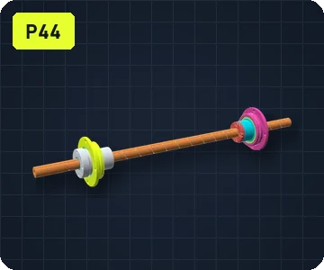</a> <b>P44</b> · bilyalı vida-mil 🔴 çok zor</td>
<td align="center" width="20%"><a href="benchmark/specs/P45-su-sogutmali-isi-emici/">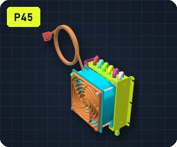</a> <b>P45</b> · su soğutmalı ısı emici 🔴 çok zor</td>
</tr>
</table>

Kartlar <a href="panel/varlik.js"><code>panel/varlik.js</code></a>'teki render'lardan
<a href="docs/img/galeri_uret.py"><code>docs/img/galeri_uret.py</code></a> ile üretilir.

## Kanal ve yayın

**Türkişi Engineering**, agentic CAD ve mühendislik üzerine bir YouTube kanalı. F23 canlı yayını **11 Kasım 2026**'da
yapıldı: beş istasyon aynı anda parça çizdi, puanlar canlı tabloya düştü. Yayın kaydı:
**[YouTube'da izle](https://www.youtube.com/watch?v=b4b8olf0IgI)**. Yayında ne gösterildiği:
[docs/yayin.md](docs/yayin.md).

<table>
<tr>
<td width="50%">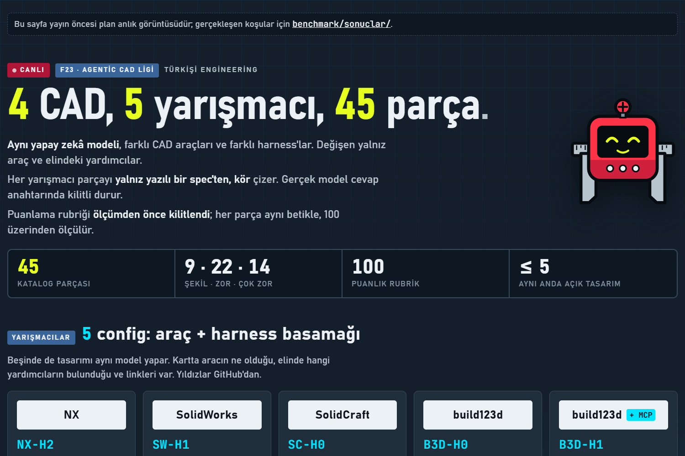 Yayın sayfası</td>
<td width="50%">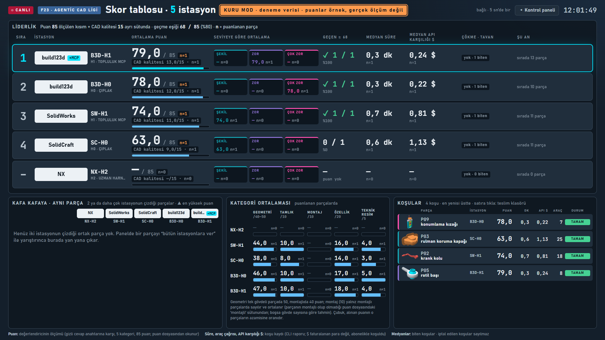 Canlı skor tablosu</td>
</tr>
<tr>
<td width="50%">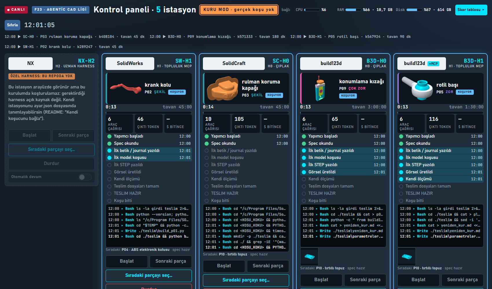 Kontrol paneli, koşu sırasında</td>
<td width="50%">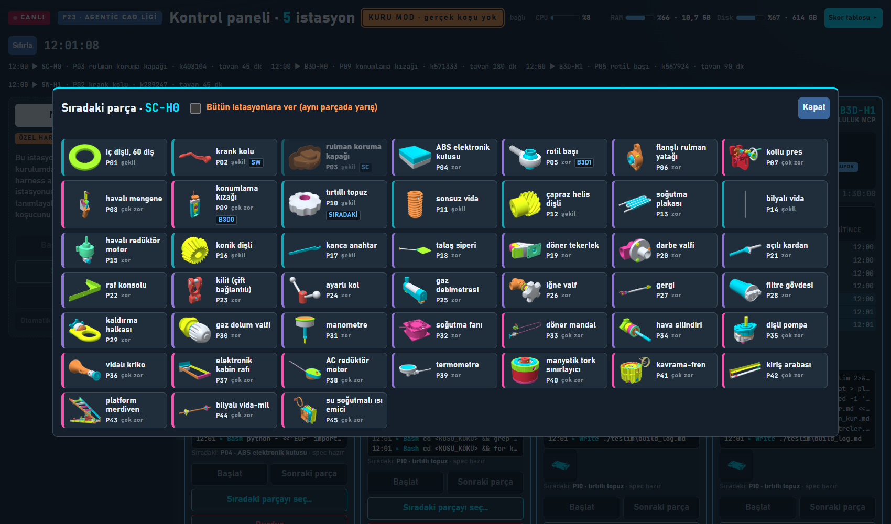 Parça seçici</td>
</tr>
</table>

## Klasörler

| Klasör | İçerik |
|---|---|
| [`tools/`](tools/) | araç kurulum rehberleri: Claude Code, SolidWorks, SolidCraft, build123d (NX yalnız "özel" notu) |
| [`benchmark/specs/`](benchmark/specs/) | parça spec'leri: **yapımcı ajanın gördüğü tek yer** |
| [`benchmark/degerlendirme/`](benchmark/degerlendirme/) | ölçüm kodu (`olc.py` …), rubrik, hedef listeleri; yalnız değerlendirici için, yapımcıya gösterilmez |
| [`benchmark/kosu/`](benchmark/kosu/) | koşu düzeneği: koşucu, guard kancası, istemler, matris |
| [`benchmark/sonuclar/`](benchmark/sonuclar/) | puanlar ve bitmiş çıktılar (SolidWorks native, build123d, SolidCraft) |
| [`panel/`](panel/) | kontrol paneli, skor tablosu, yayın sayfası |
| [`skills/`](skills/) | NX dışı CAD skill'leri ve ajanları (QA kapısı, kesit, girişim, baskı, STEP kaydı) |
| [`docs/`](docs/) | [mimari](docs/mimari.md), [yayın](docs/yayin.md), [SSS](docs/sss.md) |

Kör koşu kuralı ve klasörlerin rolü: [benchmark/README.md](benchmark/README.md).

## Hızlı başlangıç: kendi harness'ını bir spec'te dene

1. **Bir spec seç.** [`benchmark/specs/`](benchmark/specs/) altından bir parça klasörü al (ilk deneme için bir "şekil"
   seviyesi parça). Ajanına **yalnız** o `spec.md`'yi ver; web'i ve bu reponun geri kalanını kapat (guard örneği:
   [`benchmark/kosu/`](benchmark/kosu/)).
2. **Kur ve teslim et.** Ajanın modeli spec'in global çerçevesinde ve biriminde kursun, bir `teslim/` klasörüne
   `final.step`, native kaynak, `yeniden_kur.md`, `parametreler.md` ve `build_log.md` yazsın. Aracın kurulumu:
   [`tools/`](tools/).
3. **Ölç.** Teslim klasörünü [`benchmark/degerlendirme/`](benchmark/degerlendirme/)'deki `olc.py` ile puanla.
   `olc.py` her zaman bir **referans STEP** ister: varsa `benchmark/degerlendirme/hedefler/P##/referans.step` kullan.
   Bu dosya bizim en iyi koşumuzdan (≥ 84,5 / 85) üretildi; yani puanın katalog orijinaline karşı değil, **bizim en
   iyi koşumuza karşı**dır. Referansı olmayan pakette kendi referansını hazırlaman gerekir. Sonra
   [`benchmark/sonuclar/`](benchmark/sonuclar/)'daki koşularla karşılaştır.

Yeni bir araç ya da harness eklemek için: [docs/sss.md](docs/sss.md#kendi-aracımı--harnessımı-nasıl-eklerim).

## İlk sonuçlar

Canlı yayın puan dosyasındaki ([`benchmark/sonuclar/puanlar.csv`](benchmark/sonuclar/puanlar.csv), `faz = yayin`)
**26 geçerli koşunun** özeti; iptal ve yardımlı koşular hariç. 45 parça planlanmıştı; yayın bittiğinde 11 parça koşulmuştu.
Puanlar `olc.py`'nin ölçtüğü **85 üzerinden**dir (geometri, tamlık, montaj, özellik, teknik resim); CAD kalitesinin
15 puanı bu tabloda yok.

| Config | Koşu | Ortalama / 85 | Medyan / 85 |
|---|---|---|---|
| B3D-H0 | 5 | 84,49 | 84,32 |
| SW-H1 | 6 | 83,21 | 83,70 |
| NX-H2 | 6 | 82,24 | 84,06 |
| B3D-H1 | 5 | 68,00 | 84,06 |
| SC-H0 | 4 | 54,25 | 66,00 |

Okurken dikkat:

- Config'ler çoğunlukla **farklı parçalar** çizdi; bu tablo bir sıralama değil, ilk görünümdür. Dört parçada kafa kafaya
  koşu yapıldı (aynı parça dört ya da beş istasyonda).
- Ortalamayı tek bir koşu çok etkileyebilir: B3D-H1'in bir koşusu 3,5 aldı, SC-H0'ın bir koşusu süre tavanına takılıp
  `final.step` teslim edemedi (0). Medyan bu yüzden yanında.
- **MCP gerçekte ne kadar kullanıldı:** 7 koşunun hiçbirinde SW-H1 yapımcısı bir SolidWorks MCP aracı çağırmadı
  (pywin32 ile COM kodu yazdılar); B3D-H1 MCP'yi 6 koşunun yalnız 1'inde kullandı.
- Ham tablo: [`benchmark/sonuclar/puanlar.csv`](benchmark/sonuclar/puanlar.csv); bitmiş çıktılar:
  [`benchmark/sonuclar/`](benchmark/sonuclar/). Puanlama kuralları:
  [`benchmark/degerlendirme/`](benchmark/degerlendirme/).

## NX hariç

NX-H2'nin uzman harness'i (NX skill'leri, journal yardımcıları) Türkişi Engineering'in **özel** çalışmasıdır ve bu
repoda yoktur. NX-H2 koşularının native dosyaları ve akışları da paylaşılmaz; NX-H2'nin puanları sonuç tablosunda yer
alır. Orijinal katalog modelleri (STEP / PDF) de paylaşılmaz. Üçüncü taraf araçlar (MCP sunucuları, SolidCraft,
build123d) kopyalanmadı; [`tools/`](tools/) kendi repolarına link ve bizim ayarlarımızı verir.

## Lisans

[MIT](LICENSE) · © 2026 Türkişi Engineering. Üçüncü taraf araçlar kendi lisanslarına tabidir.
