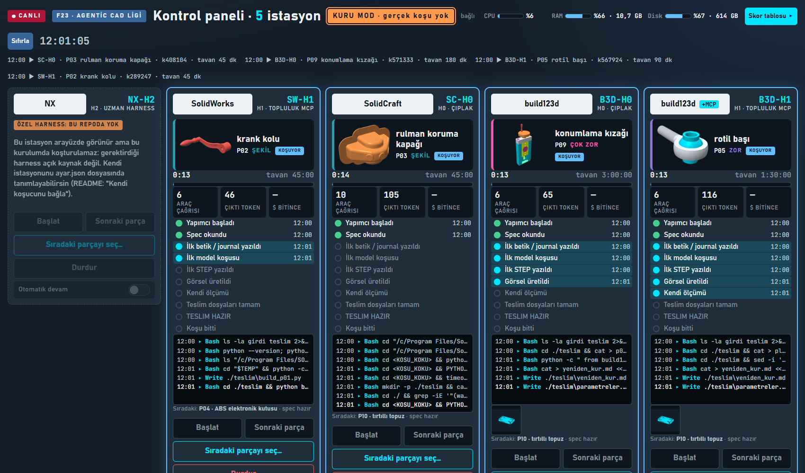
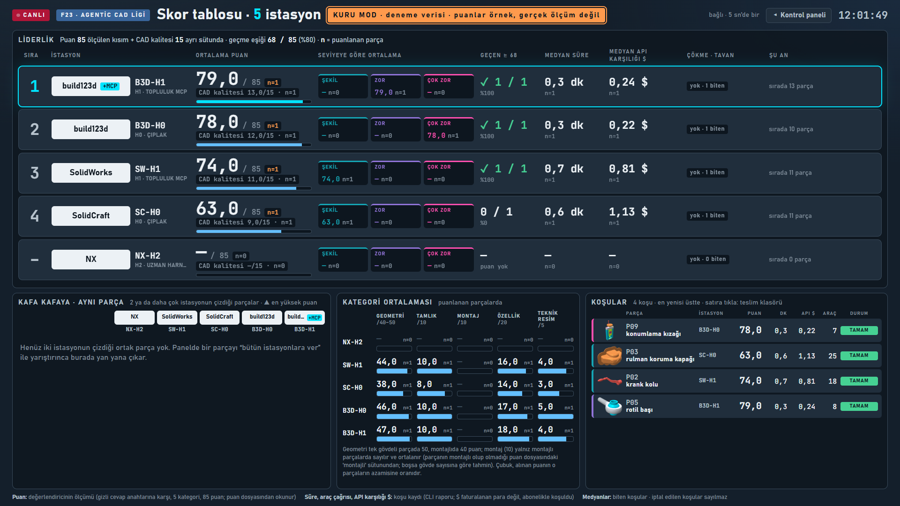
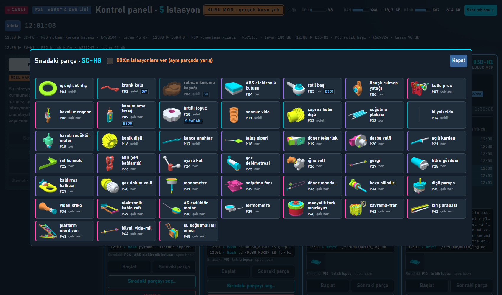

# panel: kontrol paneli, skor tablosu ve izleyici sayfası

Agentic CAD Ligi canlı yayınında beş yapımcı istasyonunu bu panelle yönettik: her istasyonun kuyruğu, başlat / sonraki /
durdur düğmeleri, yapımcı ajanın araç çağrılarının canlı akışı, kilometre taşları, süre tavanı ve skor tablosu.
Bu klasör o paneli, herkesin kendi benchmark'ında kullanabileceği bir araç olarak paylaşır.

- **Python standart kütüphanesiyle çalışır** (3.9+). `psutil` kuruluysa CPU / RAM göstergeleri ve süreç bulma da çalışır;
  kurulu değilse yalnız disk göstergesi görünür.
- **Kendisi token harcamaz, model çağırmaz.** Koşuyu senin koşucun (runner) başlatır; panel yalnız kuyruğu yürütür ve
  koşucunun yazdığı dosyaları **salt okur**.
- **Kuru (demo) mod repo'dan hemen çalışır:** gerçek bir duman testinin temizlenmiş akışlarını hızlandırılmış oynatır,
  hiçbir CAD aracı ya da yapay zekâ çağrılmaz.



*Bu README'deki bütün ekran görüntüleri kuru mod örnek verisidir: gerçek koşu ya da gerçek puan değildir.*

## Hızlı başlangıç (kuru mod)

```bash
cd panel
python panel_sunucu.py --kuru
```

Tarayıcıda `http://127.0.0.1:8765/` adresini aç. Windows'ta `PANEL.bat --kuru` sunucuyu ayrı pencerede açıp tarayıcıyı
da açar. Başka bir port için `--port 8799`.

| Adres | Ne |
|---|---|
| `/` | kontrol paneli |
| `/skor` | skor tablosu (liderlik, kafa kafaya, kategori ortalaması, koşu listesi) |
| `/yayin` | izleyici sayfası (tek dosya; `yayin_sayfasi.html` sunucusuz da açılır) |
| `/api/durum`, `/api/skor` | panelin ve skor tablosunun JSON'u |

Kuru modda ne olur:

- Kuyruklar `ornek/kuyruk/` şablonlarından `_calisma/kuru/` altına kopyalanır; gerçek dosyalara yazılmaz.
- **Başlat**, istasyonun örnek akışını (`ornek/akis/*.jsonl`) yeni bir `k123456` run_id'ye 6 kat hızlı oynatır ve
  `ornek/teslim/` dosyalarını yol boyunca teslim klasörüne kopyalar. Bitince koşucu sözleşmesindeki gibi
  `kosu_listesi.csv`'ye bir satır yazar.
- Skor tablosu boş kalmasın diye biten her kuru koşuya `ornek/ornek_puan.csv`'den **örnek puan** yazılır. Bu puanlar
  gerçek ölçüm değildir; yalnız tablonun nasıl dolduğunu gösterir.
- **NX-H2** istasyonu arayüzde görünür ama kilitlidir ("özel harness: bu repoda yok"): yayında kullandığımız NX harness'ı
  açık kaynak değildir, bu yüzden onun akışı da örneği de repoda yoktur.



*Ekran görüntüsü kuru mod örnek verisidir: puanlar `ornek/ornek_puan.csv`'den gelir, gerçek ölçüm değildir. Gerçekleşen koşuların puanları için `benchmark/sonuclar/`.*

## Panelde neler var

| Düğme / öğe | Ne yapar |
|---|---|
| **Başlat** / **Sonraki parça** | Kuyrukta durumu boş ilk satırı başlatır. `onay` tanımlı istasyonda önce onay kutusu ister (ör. "SolidWorks açık"). |
| **Sıradaki parçayı seç…** | 45 parçalık listeden istasyonun sıradaki parçasını seçer. Kuyrukta bekleyen satırsa öne alınır, yoksa yeni satır eklenir. "Bütün istasyonlara ver" ile aynı parçada yarış açılır. |
| Matristeki **×** | Henüz başlamamış satırı kuyruktan çıkarır. Satır kaybolmaz: `_calisma/<mod>/_cikarilan.csv`'ye yazılır. |
| **Durdur** | Koşunun süreç ağacını kapatır; koşu `yardimli` sayılır (liderlikten çıkar). |
| **Otomatik devam** | Koşu bitince 2 sn sonra sıradakini başlatır (`yardimli` bitişten sonra durur). |
| **Sıfırla** | Hiçbir şey silmez: kuyruklar ve panel durumu `_calisma/<mod>/_sifirlama/<zaman>/` altına kopyalanır, o ana kadarki koşular iptal dosyasına yazılır (puanlanmaz), kuyruklar boşalır. Çalışan koşu varken reddedilir. |
| Biten koşuya tıklama | Teslim klasörünü dosya yöneticisinde açar (yalnız kuyrukta kayıtlı run_id). |
| Üst bar | CPU, RAM, disk göstergeleri, son olaylar, saat, "KURU MOD" etiketi. |



## Mimari

```
            ayar.json ──────────────┐
                                    ▼
 tarayıcı  ◄──── HTTP (stdlib) ──── panel_sunucu.py ──── hazirla / baslat ────► senin koşucun
 panel.html       /api/durum          │   ▲                                      │
 skor.html        /api/skor           │   │ salt okur                            │ yazar
 yayin_sayfasi    POST /api/...       ▼   │                                      ▼
                               <kuyruk>/<istasyon>/kuyruk.csv      akis/<run_id>.jsonl        (stream-json)
                                                                   kosular/<run_id>/teslim/   (final.step, *.png, *.md)
                                                                   kosu_listesi.csv           (bitiş satırı)
                                                                   yayin_puan.csv             (değerlendiricinin puanı)
```

1. **Kuyruk = CSV.** Her istasyonun bir `kuyruk.csv`'si vardır (`sira,paket,ad,seviye,sure_dk,run_id,durum`). Durumu
   boş satır bekliyor, `kosuyor` çalışıyor, öteki değerler bitmiş demektir. Panel CSV'yi atomik yazar (`.tmp` + yer
   değiştirme), bu yüzden elle de düzenlenebilir.
2. **Akış = JSONL.** Yapımcı ajan Claude Code ile `--output-format stream-json --verbose` koşar; koşucu bu çıktıyı
   `akis/<run_id>.jsonl` dosyasına yazar. Panel dosyayı 2,5 sn'de bir **kaldığı yerden** okur (artımlı) ve şunları
   çıkarır: araç çağrısı sayısı, token, maliyet, son 8 araç çağrısının kısa özeti ve kilometre taşları.
3. **Kilometre taşları** akıştan ve teslim klasöründen gelir:

   | Taş | Nereden |
   |---|---|
   | Yapımcı başladı | `system/init` satırı |
   | Spec okundu | bir araç girdisinde `spec.md` geçmesi |
   | İlk betik / journal yazıldı | `Write` / `Edit` ile kod uzantılı dosya ya da `cat > x.py` |
   | İlk model koşusu | betikten sonra `python x.py`, `node x.js`, araç CLI'si ya da bir MCP aracı |
   | İlk STEP yazıldı | koşu klasöründe ilk `.step` / `.stp` dosyasının zamanı |
   | Görsel üretildi | `teslim/` altında ilk `.png` |
   | Kendi ölçümü | STEP'ten sonra hacim / sınır kutusu / ölçüm çağrısı |
   | Teslim dosyaları tamam | `final.step`, `yeniden_kur.md`, `parametreler.md`, `build_log.md` hepsi var |
   | TESLIM HAZIR | ajanın metninde ya da sonucunda `TESLIM HAZIR` |
   | Koşu bitti | `result` satırı |

4. **Ekrana çıkan her metin süzülür** (`GIZLE`): yapımcının koşu klasörü `./` olur, öteki mutlak yollar `~` olur,
   e-posta biçimi gizlenir. Kendi gizlemen gerekenleri (müşteri adı, parça numarası biçimi…) `ayar.json`'a
   `"gizle": ["regex", ...]` olarak ekle.
5. **Güvenlik:** sunucu yalnız `127.0.0.1`'i dinler; POST istekleri `X-Panel: 1` başlığı ister (başka bir sitenin
   tarayıcı üzerinden komut göndermesini engeller); görsel uç noktası yalnız `teslim/*.png` sunar.

## Kendi koşucunu bağla

Panel gerçek modda (`python panel_sunucu.py`, `--kuru` olmadan) yalnız `ayar.json`'daki iki komutu çağırır.
Göreli yollar `ayar.json`'un klasörüne göredir; komutlarda `{python}`, `{config}`, `{paket}`, `{sure_dk}`, `{run_id}`
yer tutucuları kullanılabilir.

Varsayılan ayar bu repodaki koşucuya, [`benchmark/kosu/kos.py`](../benchmark/kosu/)'ya bağlıdır. Yollardaki `{IS}`
koşucunun iş köküdür ve kos.py ile aynı biçimde çözülür: `TCAD_IS_KOKU` ortam değişkeni varsa o, yoksa
`benchmark/kosu/_is/`. Panel ortam değişkenlerini kos.py'ye olduğu gibi geçirir; `TCAD_MCP_KOKU`, `CLAUDE_CLI`,
`SOLIDCRAFT_CLI` gibi koşucu ayarlarını paneli başlattığın kabukta ver (ayrıntı: `benchmark/kosu/README.md`).

```json
"is_koku": {"ortam": "TCAD_IS_KOKU", "varsayilan": "../benchmark/kosu/_is"},
"gercek": {
  "kuyruk_klasoru": "_calisma/gercek/kuyruk",
  "kuyruk_sablonu": "ornek/kuyruk",
  "kosucu_klasoru": "../benchmark/kosu",
  "hazirla": ["{python}", "kos.py", "hazirla", "--config", "{config}", "--parca", "{paket}", "--gorev", "A",
              "--faz", "Y", "--tekrar", "1", "--sure-dk", "{sure_dk}"],
  "baslat":  ["{python}", "kos.py", "baslat", "{run_id}"],
  "akis_klasoru": "{IS}/kayit/akis",
  "kosular_klasoru": "{IS}/kosular",
  "kosu_listesi": "{IS}/kayit/kosu_listesi.csv",
  "puan_dosyasi": "{IS}/sonuc/yayin_puan.csv",
  "iptal_dosyasi": "{IS}/kayit/yayin_iptal.txt",
  "hazir_dosyasi": null,
  "faz": "Y"
}
```

kos.py ile eşleşme:

| Panel | kos.py |
|---|---|
| `hazirla` | `kos.py hazirla --config <SW-H1 \| SC-H0 \| B3D-H0 \| B3D-H1 …> --parca <P..> --gorev A --faz Y --tekrar 1 --sure-dk <dk>`; stdout'a yalnız run_id yazar (`r` + 6 rakam). Yapımcıya kopyalanan girdi `{IS}/paketler/<paket>/A/` klasörüdür: paket kodları `parcalar.csv` ile aynı olmalı. |
| `baslat` | `kos.py baslat <run_id>`: claude oturumunu ön planda yürütür, süre tavanında süreç ağacını kapatır (`tavan`). |
| akış | `{IS}/kayit/akis/<run_id>.jsonl` (koşu klasörünün dışında; yapımcı göremez) |
| teslim | `{IS}/kosular/<run_id>/teslim/` |
| bitiş satırı | son stdout satırı `{"run": …, "durum": "tamam" \| "tavan" \| "cokme", "dk": …, "usd": …, "arac": …, "red": <guard red sayısı>}` |
| koşu kaydı | `{IS}/kayit/kosu_listesi.csv`'ye bir satır, **başlık satırı yazmadan**; panel başlıksız dosyayı aşağıdaki sütun sırasıyla okur |
| puan | `benchmark/kosu/yayin_puanla.py` `{IS}/sonuc/yayin_puan.csv`'yi yazar; panelin **Sıfırla**'sı `{IS}/kayit/yayin_iptal.txt`'ye yazar, puanlayıcı bu koşuları puanlamaz |
| durdur | panel `kos.py baslat` sürecini çocuklarıyla (claude) birlikte kapatır, koşu `yardimli` olur |

Konfigürasyonu kos.py'de tanımlı olmayan bir istasyon (yayındaki NX-H2 gibi) `ozel: true` kalmalıdır; yoksa `hazirla`
"invalid choice" ile reddedilir ve panel "koşucu 'hazirla' başarısız" gösterir.

Panelin koşucudan beklediği sözleşme:

| Adım | Koşucu ne yapar |
|---|---|
| `hazirla` | Koşuyu hazırlar (çalışma klasörü, spec kopyası, ayarlar) ve **stdout'a run_id'yi yazar**. Panel çıktıdaki son `run_id_deseni` eşleşmesini alır (varsayılan `[a-z]\d{6}`, ör. `r123456`). Sıfır dışı çıkış kodu = başarısız. |
| `baslat` | Koşuyu **ön planda** yürütür ve bitince çıkar (süre tavanını koşucu uygular). Panel bu süreci `kosuyor` sayar; çıktısı `_calisma/<mod>/_log/<run_id>.out`'a yazılır. |
| akış dosyası | Koşu sürerken `akis_klasoru/<run_id>.jsonl`'ye yapımcının stream-json çıktısını satır satır yazar. |
| teslim klasörü | Yapımcının çıktıları `kosular_klasoru/<run_id>/teslim/` altında (`final.step`, `*.png`, `*.md`). |
| bitiş durumu | `baslat` stdout'unun **son JSON satırı**: `{"durum": "tamam", "dk": 38.2, "usd": 4.12, "arac": 61, "red": 0}`. `durum` şunlardan biri: `tamam`, `tavan`, `cokme`. JSON yoksa panel `kosu_listesi.csv`'deki `durum`'a, o da yoksa `cokme`'ye düşer. |
| `kosu_listesi.csv` | Her koşu için bir satır ekler (başlık satırı olsa da olmasa da okunur). |

`kosu_listesi.csv` sütunları (başlık satırı isteğe bağlı; yoksa bu sıra kabul edilir):

```
run_id,faz,config,parca,gorev,tekrar,basla,bitis,sure_dk,token_in,token_out,token_cache,usd,tool_cagri,cokme,durum,not
```

Panel bunlardan `run_id, faz, config, parca, basla, sure_dk, usd, tool_cagri, durum` sütunlarını okur. `faz` ayarı boş
değilse skor tablosu yalnız o fazdaki satırları sayar (yayında `Y` = yayın koşusu, deneme koşuları dışarıda kaldı).

Skor tablosunun okuduğu `yayin_puan.csv` (değerlendirici yazar, panel salt okur):

```
run_id,config,paket,durum_kosu,puan_85,geometri,tamlik,montaj,ozellik,resim,montajli,iptal,not
```

- `puan_85` ölçülen kısmın toplamı (85 üzerinden); kategoriler geometri 40–50, tamlık 10, montaj 10, özellik 20,
  teknik resim 5. Adında `kalite` geçen bir sütun varsa (ör. `kalite_15`) ayrı bir "CAD kalitesi /15" olarak gösterilir.
- `montajli` 1 ya da 0: montaj puanı yalnız montajlı parçada ortalamaya girer.
- `iptal` 1 olan satır ve iptal dosyasındaki run_id'ler tabloya girmez. Aynı run_id iki kez yazıldıysa sonuncusu geçer.
- Geçme eşiği 68 / 85 (%80); `panel_sunucu.py`'de `GECME_ESIGI`.

İstasyonlar da `ayar.json`'dadır. `onay` metni olan istasyon başlatmadan önce onay ister; `ozel: true` olan istasyon
arayüzde görünür ama koşturulamaz:

```json
{"kod": "SW-H1", "arac": "SolidWorks", "basamak": "H1 · topluluk MCP", "onay": "SolidWorks açık, son dosyalar paneli kapalı"}
```

Parça listesi `ornek/parcalar.csv` (`paket,ad,seviye,sure_dk,resim,...`); `resim` sütunu `varlik.js`'deki küçük
render'ın anahtarıdır. Kendi parçaların için kendi CSV'ni ve render'larını koy; render yoksa kart boş kalır.

`hazir_dosyasi` verilirse yalnız o dosyada (her satırda bir paket kodu) yazan paketler başlatılabilir; böylece spec'i
henüz yazılmamış parça kuyruğa girse de başlamaz. `null` ise bütün paketler hazır sayılır.

## Dosyalar

| Dosya | Ne |
|---|---|
| `panel_sunucu.py` | sunucu + orkestratör + kuru mod oynatıcı (tek dosya) |
| `ayar.json` | istasyonlar, yollar, koşucu komutları, kuru mod kaynakları |
| `panel.html`, `skor.html` | kontrol paneli ve skor tablosu (tek dosya HTML + JS, derleme yok) |
| `yayin_sayfasi.html` | yayında izleyicilere gösterdiğimiz sayfa: yarışmacılar, harness merdiveni, 5 × 9 matris, kurallar. Durum, sayfanın başındaki JSON bloğundan okunur. **Yayın öncesi plan anlık görüntüsüdür**; gerçekleşen koşular ve puanlar için `benchmark/sonuclar/`. |
| `varlik.js` | 45 parçanın küçük render'ı (webp, base64). Marka logosu yoktur; araç adları metin olarak yazılır. |
| `ornek/` | kuru mod verisi: `parcalar.csv`, `kuyruk/<istasyon>/kuyruk.csv` (NX-H2 için örnek kuyruk yok; panel o istasyonu boş kuyrukla açar), `akis/*.jsonl` (dört istasyonun temizlenmiş duman testi akışı, NX hariç), `teslim/` (örnek plaka STEP'i ve md dosyaları), `ornek_puan.csv` |
| `PANEL.bat` | Windows kısayolu |
| `ekran/` | bu README'nin ekran görüntüleri |
| `_calisma/` | çalışma durumu (kuyruk kopyaları, akışlar, günlükler, sıfırlama arşivleri); `.gitignore`'da |

Örnek akışlar gerçek bir duman testinden (100 × 60 × 10 mm deneme plakası) gelir; düşünce blokları atıldı, uzun araç
çıktıları kısaltıldı, yollar `./`, `<KOSU_KOKU>` (yapımcının geçici çalışma klasörü) ya da `<YOL>` ile değiştirildi; herkese açık kurulum yolları (`C:\Program Files\…`) olduğu gibi kaldı. Makine izi taşıyan araç çıktıları (kurulu ürün listesi, kayıt defteri, süreç numarası, kurulum klasörü dökümü) kısaltıldı.

## Lisans

MIT (repo kökündeki `LICENSE`).
